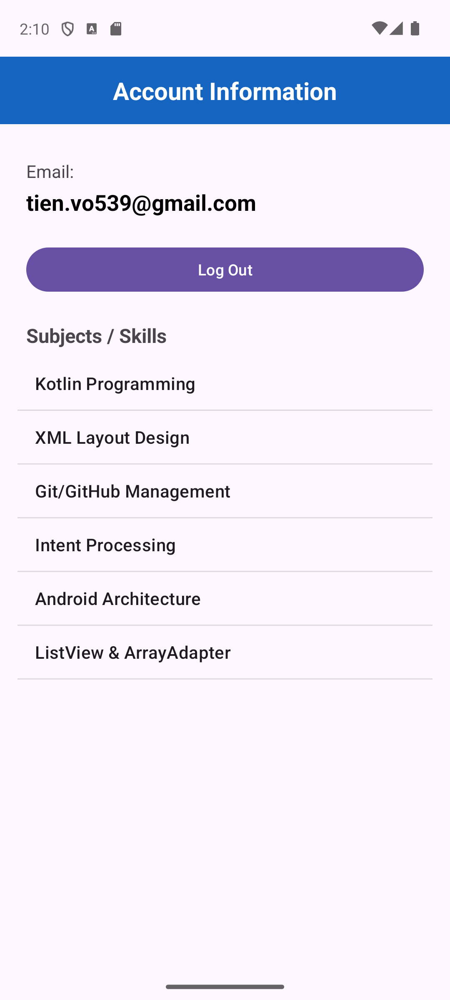
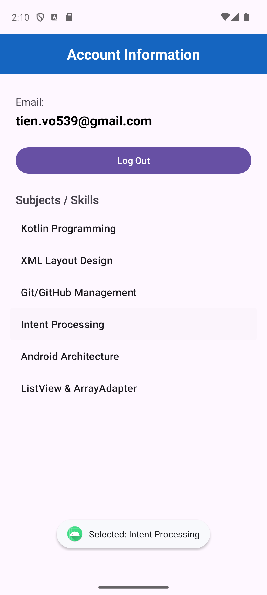

# KiemTra_LapTrinhUngDungDiDong_2474802010391
Repo bài kiểm tra thực hành môn Lập trình ứng dụng di động
# BÀI THI THỰC HÀNH - CÂU 1
- **Họ và tên:** Võ Việt Tiến
- **MSSV:** 2474802010391
- **Tên dự án:** KiemTra_LapTrinhUngDungDiDong_2474802010391

---

## Minh chứng Câu 1
### 1. Thông báo lỗi khi dữ liệu không hợp lệ

### 2. Xác thực thành công khi dữ liệu hợp lệ

## Minh chứng Câu 2

## Minh chứng Câu 3

Thêm ListView vào ProfileActivity (bên dưới email và nút Log Out), dữ liệu là mảng 6 môn học/kỹ năng, gắn bằng ArrayAdapter với android.R.layout.simple_list_item_1. Bấm vào một dòng sẽ hiện Toast tên môn được chọn.

