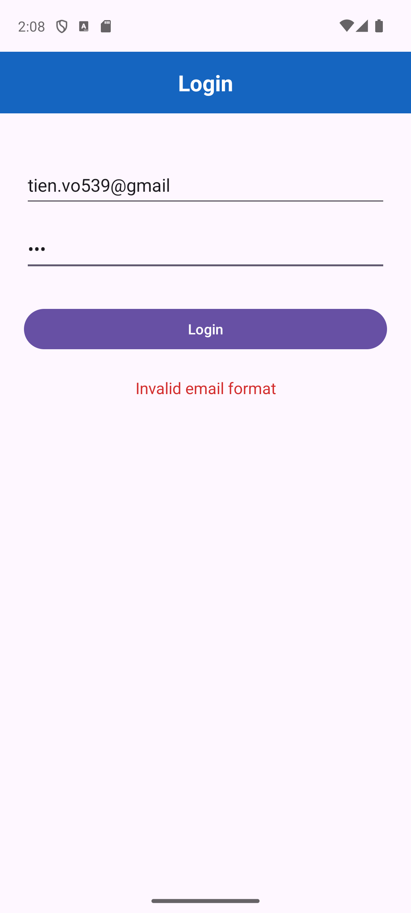
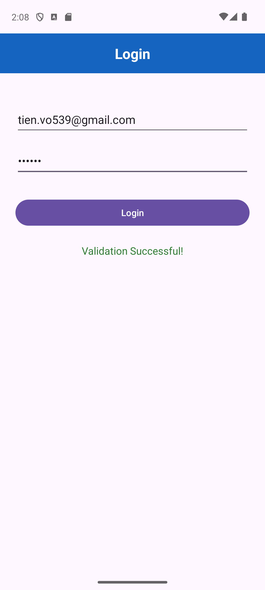
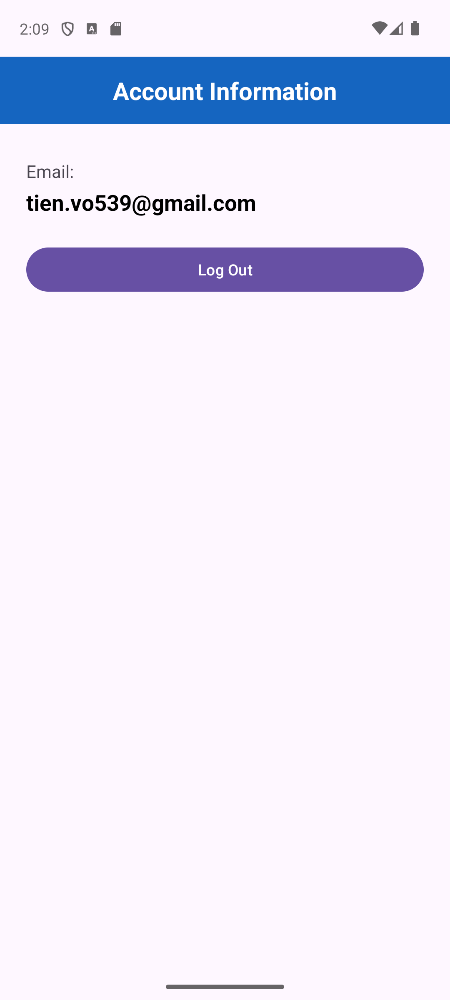

# Kiểm tra thực hành - Lập trình ứng dụng di động

- Họ tên: Võ Việt Tiến
- MSSV: 2474802010391

## Minh chứng Câu 1

Màn hình LoginActivity (ConstraintLayout, ánh xạ bằng findViewById, không dùng ViewBinding). Kiểm tra email/password rỗng, sai định dạng email (Patterns.EMAIL_ADDRESS) và password dưới 6 ký tự.

## Minh chứng Câu 2

Đăng nhập hợp lệ thì dùng explicit Intent chuyển sang ProfileActivity, email được gửi qua putExtra() và hiển thị ở màn hình Account Information. Nút Log Out gọi finish() để quay lại LoginActivity.

